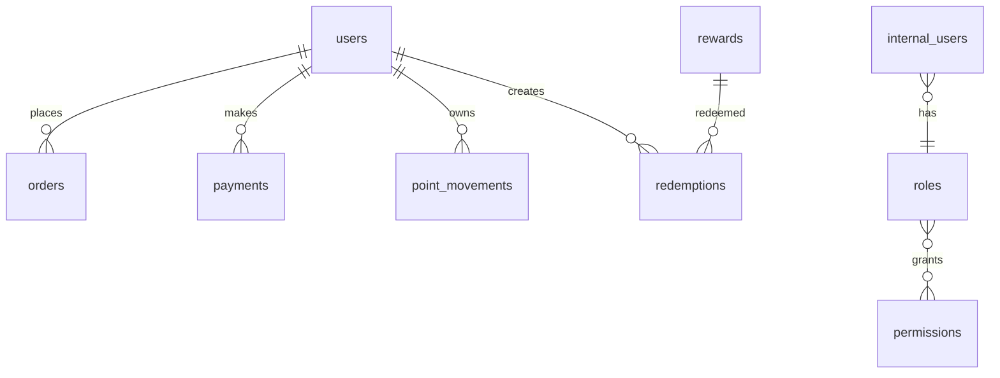
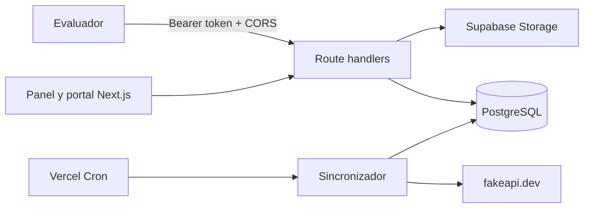

# Sistema de lealtad

Aplicación Next.js para sincronizar clientes, pedidos y pagos desde fakeapi.dev,
calcular puntos con corte fijo al 30 de abril de 2026 y ofrecer panel interno y
portal de clientes.

## Ejecución local

```bash
pnpm install
pnpm dev
```

La base PostgreSQL debe tener las tablas usadas por `lib/services/syncService.js`,
`users`, `orders`, `payments`, `point_movements`, `rewards`, `redemptions`,
`internal_users`, `roles`, `permissions`, `role_permissions` y `api_tokens`.
Ejecuta `pnpm exec node scripts/seed-admin.js` después de crear el rol administrador.

## Variables de entorno

```env
DATABASE_URL=
FAKE_API_KEY=
NEXT_PUBLIC_SUPABASE_URL=
SUPABASE_SERVICE_ROLE_KEY=
JWT_SECRET=
CRON_SECRET=
```

Las variables se consumen únicamente en el servidor. Nunca publiques `.env.local`.

## Flujos disponibles

- Personal interno: `/auth/login` y `/dashboard`.
- Recompensas: `/admin/rewards`.
- Portal de clientes: `/client/login` y `/client`.
- Endpoints de validación: `/api/fidelizacion/*`, con `Authorization: Bearer <token>`.
- Cron diario: `/api/sync/cron`, protegido con `CRON_SECRET`.

El portal crea una sesión HTTP-only para el cliente; el `clientId` nunca se acepta
desde el navegador para cambiar contraseña o canjear.

## Decisiones técnicas

- PostgreSQL conserva datos sincronizados y el historial de puntos.
- La sincronización reemplaza solo movimientos derivados de la fuente (`pago`,
  `reembolso` y `bono_orden_entregada`), preservando canjes y haciendo el proceso
  repetible.
- Los canjes bloquean cliente y recompensa dentro de una transacción para evitar
  saldo negativo y sobreventa de stock.
- Las imágenes se guardan en Supabase Storage; la base solo conserva la URL.

## Modelo de datos



## Arquitectura



## Getting Started

First, run the development server:

```bash
npm run dev
# or
yarn dev
# or
pnpm dev
# or
bun dev
```

Open [http://localhost:3000](http://localhost:3000) with your browser to see the result.

You can start editing the page by modifying `app/page.js`. The page auto-updates as you edit the file.

This project uses [`next/font`](https://nextjs.org/docs/app/building-your-application/optimizing/fonts) to automatically optimize and load [Geist](https://vercel.com/font), a new font family for Vercel.

## Learn More

To learn more about Next.js, take a look at the following resources:

- [Next.js Documentation](https://nextjs.org/docs) - learn about Next.js features and API.
- [Learn Next.js](https://nextjs.org/learn) - an interactive Next.js tutorial.

You can check out [the Next.js GitHub repository](https://github.com/vercel/next.js) - your feedback and contributions are welcome!

## Deploy on Vercel

The easiest way to deploy your Next.js app is to use the [Vercel Platform](https://vercel.com/new?utm_medium=default-template&filter=next.js&utm_source=create-next-app&utm_campaign=create-next-app-readme) from the creators of Next.js.

Check out our [Next.js deployment documentation](https://nextjs.org/docs/app/building-your-application/deploying) for more details.
